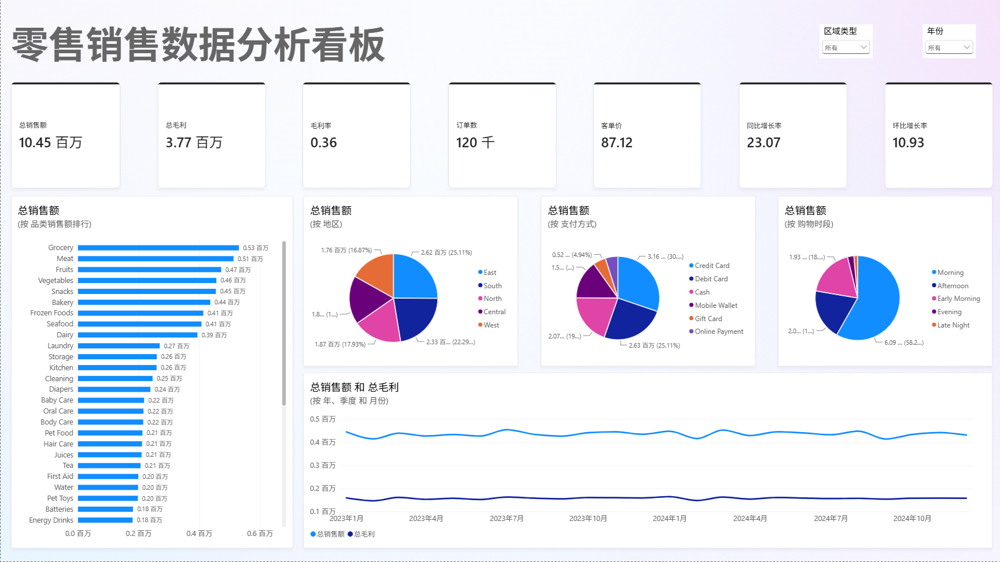
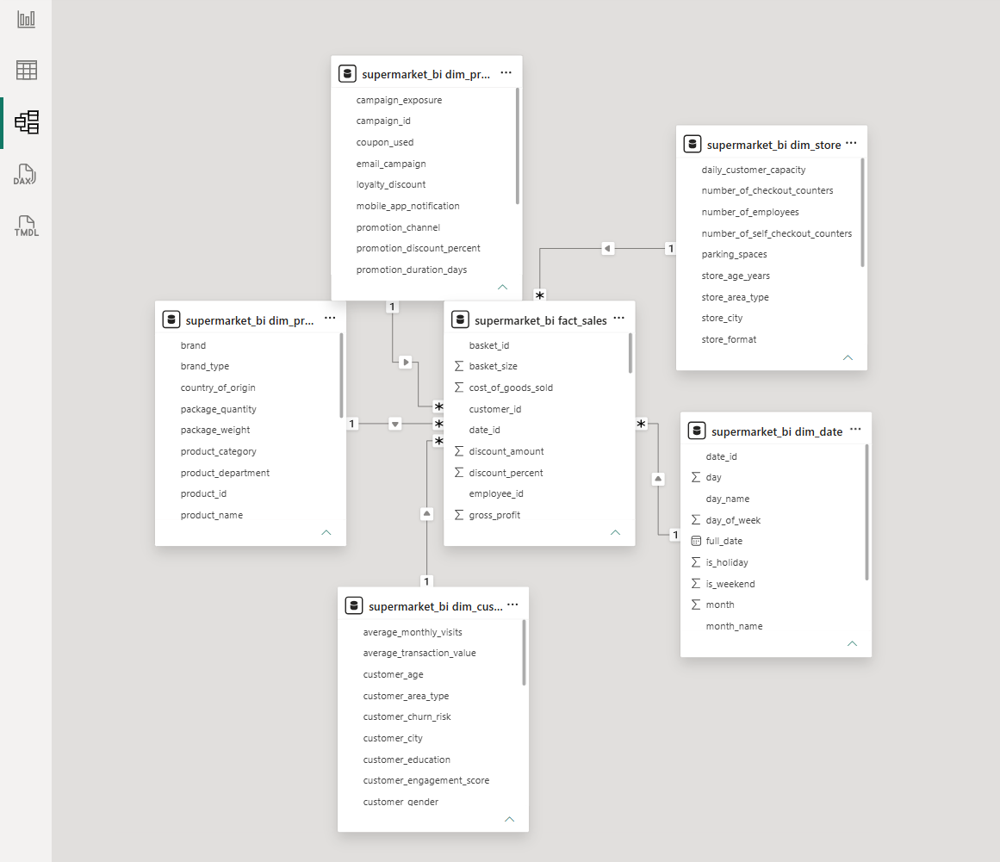
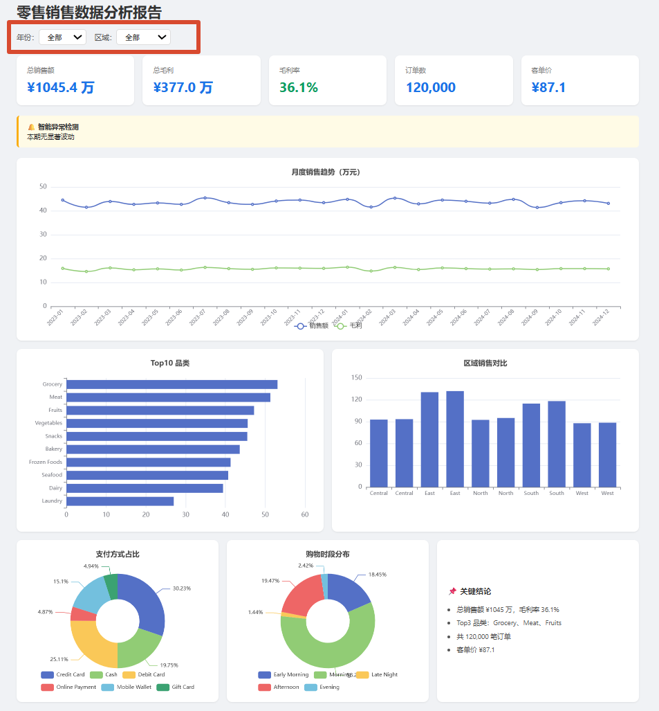

# 零售销售数据分析看板（Supermarket BI Dashboard）

基于Kaggle公开零售数据集，完成从数据建模到可视化分析并生成智能分析报告的完整BI项目链路。

🔗 **在线体验**：[交互式分析报告](https://peng-yue508.github.io/supermarket_bi_dashboard/report.html)

## 项目架构

**数据源** → Kaggle CSV（12万行）

**数据处理** → Python ETL脚本 → MySQL星型数据库（6张表）

**输出** → 两个方向：
1. Power BI Desktop交互看板（KPI、趋势图、切片器）
2. Python 自动生成HTML报告（可切片筛选，结论根据筛选条件自动输出）

## 技术栈

- **数据库**：MySQL 8.0（星型模型，事实表 + 5张维度表）
- **ETL**：Python + Pandas（CSV分块读取、空值处理、维度去重、批量入库）
- **可视化**：Power BI Desktop（DAX度量值、切片器、同环比分析）
- **自动报告**：Python + Pyecharts（交互式HTML报告，支持年份、区域筛选）

## 数据集

Kaggle: [Supermarket Dataset](https://www.kaggle.com/datasets/datascikhan/supermarket)

- 120,000笔交易记录
- 75,799位客户
- 200家门店
- 5,000个商品，45个品类
- 时间跨度：2023.01-2024.12（两年连续完整数据）

## 核心指标

| 指标 | 数值 |
|---|---|
| 总销售额 | ¥10,454,216 |
| 总毛利 | ¥3,770,442 |
| 毛利率 | 36.1% |
| 订单数 | 120,000 |
| 客单价 | ¥87.12 |

## 文件说明

| 文件 | 说明 |
|---|---|
| `01_star_schema.sql` | MySQL建表SQL（星型模型DDL） |
| `02_etl_to_mysql.py` | Python ETL脚本：CSV → 拆表 → 入库MySQL |
| `03_dax_measures.md` | Power BI DAX度量值清单（KPI、同环比、排名） |
| `04_smart_report.py` | Python自动生成交互式HTML分析报告 |
| `config.example.py` | 数据库配置模板（需用记事本打开，自行填写密码） |
| `report.html` | 生成的交互式报告示例 |

## 本地运行

### 前置环境

- MySQL 8.0+（需安装MySQL Connector/NET驱动，用于连接Power BI）
- Python 3.10+
- Power BI Desktop（Windows）

### 步骤

1. **启动MySQL服务**，创建数据库：

   CREATE DATABASE supermarket_bi DEFAULT CHARACTER SET utf8mb4;

2. **执行建表SQL**：用MySQL Workbench打开`01_star_schema.sql`，全选执行，创建6张表（fact_sales + dim_date/customer/product/store/promotion）。

3. **配置数据库连接**：复制`config.example.py`为`config.py`，填入自己的MySQL root密码。

4. **安装Python依赖**：

   pip install pandas pymysql pyecharts

5. **运行ETL脚本**，将CSV数据导入 MySQL：

   python 02_etl_to_mysql.py

   等待输出"ETL 完成"，预期入库120,000行事实数据。

6. **运行智能报告脚本**，生成交互式 HTML：

   python 04_smart_report.py

   输出`report.html`，用浏览器打开即可查看。

8. **配置Power BI Desktop**：
   - 获取数据 → MySQL数据库 → 服务器填localhost，数据库填supermarket_bi
   - 导入全部6张表
   - 在模型视图中建立关系：fact_sales的date_id/customer_id/product_id/store_id/promotion_id分别连接到对应维度表
   - 参考`03_dax_measures.md`创建度量值，拖拽生成看板

## 看板功能

- KPI卡片：总销售额、总毛利、毛利率、订单数、客单价、同比/环比增长率
- 月度销售趋势折线图
- Top10品类销售排行
- 区域销售对比
- 支付方式占比
- 购物时段分布
- 年份、区域切片器联动筛选

## 看板预览

### Power BI 交互看板

### 数据模型（星型模型）

### 交互式 HTML 报告

## 项目亮点

- **完整链路**：从原始CSV到最终可视化全链路
- **数据建模**：323列宽表拆分为星型模型，消除冗余，支持多维度分析
- **交互设计**：Power BI看板和HTML报告均支持筛选联动
- **可复用的方法论**：星型模型设计思路、ETL分块处理流程、看板搭建方法可以迁移到其他零售类数据集
